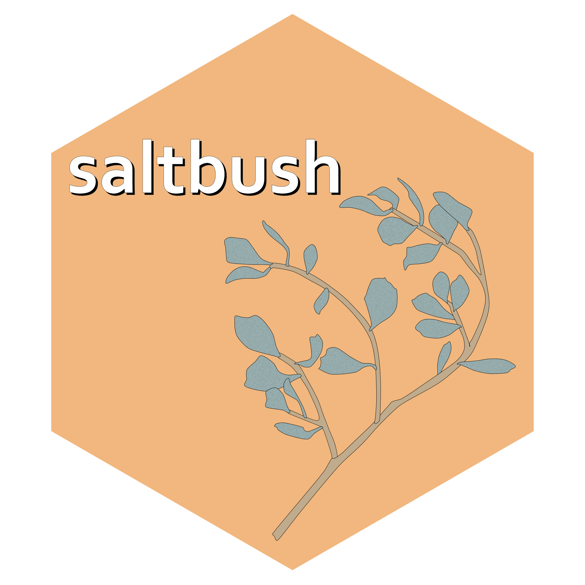

<!-- README.md is generated from README.Rmd. Please edit that file -->

```{r, include = FALSE}
knitr::opts_chunk$set(
  collapse = TRUE,
  comment = "#>",
  fig.path = "man/figures/README-",
  out.width = "90%"
)

library(saltbush)
```

<!-- badges: start -->
[](https://lifecycle.r-lib.org/articles/stages.html#stable)
[](https://github.com/traitecoevo/saltbush/actions/workflows/R-CMD-check.yaml)
[](https://app.codecov.io/gh/traitecoevo/saltbush)
[](https://zenodo.org/badge/latestdoi/859674921)
<!-- badges: end -->

# saltbush 

*saltbush* processes drone imagery to calculate spectral diversity values as part of the assessment of the 'spectral variability hypothesis' or the 'spectral-biodiversity relationship'. This was specifically implemented to connect *from-the-sky* diversity with *on-the-ground* diversity as measured in the AusPlots project. There are functions to calculate on-the-ground diversity built on the [ausplotsR](https://github.com/ternaustralia/ausplotsR) and [vegan](https://github.com/vegandevs/vegan) packages. This package is aimed at making from-the-sky diversity methods development easier for researchers across the world.

Specifically we have used this package in a test in the Australian arid zone. The results suggest that some of the methods below perform much better than others. The code that reproduces that full analysis is available at [adelegem/multispectral_drone_svh](https://github.com/adelegem/multispectral_drone_svh).

## Installation

```{r install, eval = FALSE}
install.packages("remotes")
remotes::install_github("traitecoevo/saltbush", build_vignettes = TRUE)
```

## Workflow

**From the sky**: drone imagery to spectral diversity

1. `create_multiband_image()`: stack single-band reflectance TIFs into one multiband image
2. `find_optimum_thresholds()`: *(optional)* choose NDVI/NIR thresholds from ground-truth points
3. `create_masked_raster()`: mask out bare ground and shadow
4. `calculate_spectral_metrics()`: CV, SV and CHV for each area of interest (AOI)

**On the ground**: survey data to taxonomic diversity

5. `calculate_field_diversity()`: species richness, Shannon, Simpson and more

**Together**: join the two by site or AOI to test the spectral-biodiversity relationship.

The example below runs every step on data bundled with the package, all from AusPlots site NSABHC0009 at Fowlers Gap, NSW. For more detail on each step, see `vignette("saltbush")`.

### 1. Build a multiband image

For users using Pix4D mapper to pre-process imagery, single-band TIFs will be saved in a folder per site. You can optionally use this function to create a multiband image - each file name must be the band name or end with it, so Pix4D output such as `NSABHC0009_transparent_reflectance_blue.tif` works without renaming. Output files are named after the folder.

```{r multiband}
wavelengths <- c("blue", "green", "red", "red_edge", "nir")

band_dir <- system.file("extdata/create_multiband_image", package = "saltbush")
list.files(band_dir)

multiband <- create_multiband_image(band_dir, 
                                    desired_band_order = wavelengths,
                                    output_dir = tempdir(),
                                    make_plot = FALSE)
```

```{r drone-clip-setup, include = FALSE}
# Render the README clips from a full-resolution image when it is available
# locally (data-raw/readme-hires/, git-ignored and excluded from the package),
# otherwise fall back to the multiband image built above so the README still
# builds anywhere. The package itself only ever ships the low-res version.
hires_clip <- "data-raw/readme-hires/multiband_image.tif"
drone <- if (file.exists(hires_clip)) terra::rast(hires_clip) else multiband
names(drone) <- wavelengths
```

The five bands of the resulting image:

```{r drone-clip-bands, echo = FALSE, dpi = 150, fig.width = 8, fig.height = 5, fig.alt = "The five spectral bands (blue, green, red, red edge, NIR) of the example drone image", out.width = "100%"}
terra::plot(drone)
```

and as a true-colour composite:

```{r drone-clip-rgb, echo = FALSE, dpi = 150, fig.width = 6, fig.height = 6, fig.alt = "True-colour composite of the example drone image", out.width = "60%"}
terra::plotRGB(drone, r = 3, g = 2, b = 1, stretch = "hist")
```

### 2. Choose masking thresholds *(optional)*

If you have ground-truth points labelled by class (e.g. vegetation vs bare ground), `find_optimum_thresholds()` finds the NDVI or NIR value that best separates them, per site:

```{r thresholds, eval = FALSE}
ndvi_thresholds <- find_optimum_thresholds(ground_truth,
                                           site_col = "site",
                                           band_or_index_col = "ndvi",
                                           class_col = "class",
                                           class_value = c("bare_ground", "rocks"))
```

Otherwise, pass single threshold values to the next step, as below.

### 3. Mask out non-vegetation

The image above is a small clip, so from here on we use a bundled image of the whole NSABHC0009 plot (aggregated to 1.5 m pixels to keep the package small). Pixels with NDVI below `ndvi_threshold` (bare ground) or NIR below `nir_threshold` (shadow) are set to `NA`:

```{r mask, results = "hide"}
plot_image <- system.file("extdata/example/NSABHC0009_aggregated.tif",
                          package = "saltbush")

create_masked_raster(plot_image,
                     output_dir = tempdir(),
                     ndvi_threshold = 0.02,
                     nir_threshold = 0.04)

masked_image <- file.path(tempdir(), "NSABHC0009_aggregated_masked.tif")
```

### 4. Calculate spectral metrics

`calculate_spectral_metrics()` crops and masks each image to its AOI polygons and calculates the metrics directly from the raster. Rasters and AOI files are matched by site name, the start of the file name up to the first `_` or `.` (here `NSABHC0009`). AOIs can be shapefiles, GeoJSON or GeoPackage, and are reprojected to the image's coordinate system if needed.

```{r spectral}
aoi_file <- system.file("extdata/aoi/NSABHC0009_aoi.shp", package = "saltbush")

spectral <- calculate_spectral_metrics(masked_image, aoi_file, wavelengths)
spectral
```

### 5. Calculate field diversity

For AusPlots point-intercept data (e.g. from `ausplotsR::get_ausplots()`), the defaults work as is, each row in one point-observation, and dead material is excluded:

```{r field-ausplots}
field <- calculate_field_diversity(ausplots_NSABHC0009)
field$taxonomic_diversity
```

For other surveys, name the species column, any categories to exclude, and an abundance column such as percent cover or counts. Here, using the bundled example cover data:

```{r field-cover}
head(cover_survey)

cover <- calculate_field_diversity(cover_survey,
                                   aoi_cols = "plot_id",
                                   species_col = "species",
                                   exclude = c("Bare ground", "Litter"),
                                   abundance_col = "cover_pct")
cover$taxonomic_diversity
```

### 6. Bring them together

Join spectral and field diversity by site (or by AOI, if your field plots match your AOIs):

```{r join}
merge(spectral, field$taxonomic_diversity,
      by.x = "site", by.y = "site_location_name")
```

This shows the mechanics for one site, but multiple sites can be run through saltbush as inputs accept lists or files / folders.

## Diversity metrics computed

**Spectral diversity** (from drone imagery):

- coefficient of variation (CV)
- spectral variance (SV)
- convex hull volume (CHV)

**Taxonomic diversity** (from survey data):

- Species richness
- Shannon's diversity index
- Simpson's diversity index
- Pielou's evenness
- Exponential Shannon's index
- Inverse Simpson's index
