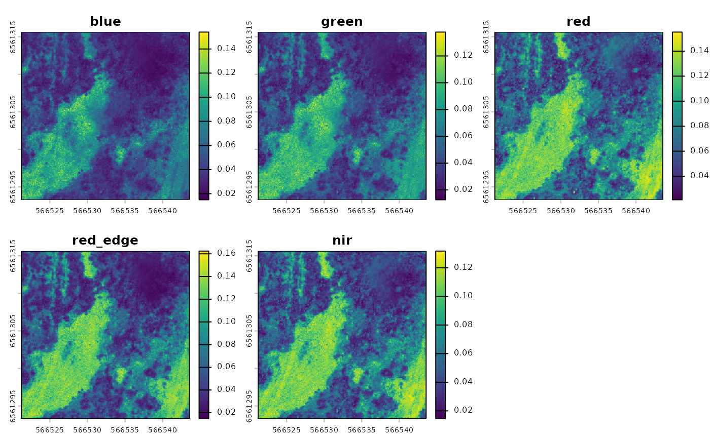

# Getting started with saltbush

This vignette walks through a complete spectral-diversity workflow using
only data shipped with the package, so it runs offline. The workflow has
two halves that you eventually combine:

1.  **From-the-sky:** turn drone imagery into spectral-diversity metrics
    per area-of-interest (AOI).
2.  **From-the-ground:** turn AusPlots point-intercept data into
    taxonomic-diversity metrics per site.

## 1. Build a multiband image from single-band TIFs

The example data ships with five single-band TIFs from a drone flight
over Fowlers Gap, NSW (`blue`, `green`, `red`, `red_edge`, `nir`).

``` r

input_dir <- system.file("extdata/create_multiband_image",
                         package = "saltbush")

multiband <- create_multiband_image(
  input_dir,
  desired_band_order = c("blue", "green", "red", "red_edge", "nir"),
  output_dir = tempdir(),
  return_raster = TRUE
)
```



## 2. Choose areas of interest

We then pair the multiband image with an area-of-interest (AOI) file.
The package ships a small aggregated raster and matching AOI for
demonstration:

``` r

raster_files <- list.files(
  system.file("extdata/example", package = "saltbush"),
  pattern = "\\.tif$", full.names = TRUE
)

aoi_files <- list.files(
  system.file("extdata/aoi", package = "saltbush"),
  pattern = "NSABHC0009_aoi\\.shp$", full.names = TRUE
)
```

AOI files can be shapefiles, GeoJSON or GeoPackage. If an AOI’s
coordinate system differs from the imagery’s, it is reprojected to
match.

## 3. Calculate spectral metrics

[`calculate_spectral_metrics()`](https://traitecoevo.github.io/saltbush/reference/calculate_spectral_metrics.md)
works directly from the rasters, cropping and masking them to each AOI,
and returns three metrics per AOI:

- **CV** — coefficient of variation
- **SV** — spectral variance
- **CHV** — convex hull volume

``` r

metrics <- calculate_spectral_metrics(
  raster_files, aoi_files,
  wavelengths = c("blue", "green", "red", "red_edge", "nir"),
  masked = FALSE,
  rarefaction = FALSE
)
metrics
#>         site aoi_id       CV          SV          CHV image_type
#> 1 NSABHC0009      1 0.334488 0.001761305 3.347609e-10   unmasked
```

## 4. Compute on-the-ground taxonomic diversity

For the from-the-ground side, the package ships a cached AusPlots
point-intercept dataset for the same site (`NSABHC0009`) so the worked
example does not need network access:

``` r

field_diversity <- calculate_field_diversity(ausplots_NSABHC0009)
field_diversity$taxonomic_diversity
#>        site_unique site_location_name species_richness shannon_diversity
#> 1 NSABHC0009-58026         NSABHC0009               52          3.056908
#> 2 NSABHC0009-53604         NSABHC0009               38          2.843074
#>   simpson_diversity pielou_evenness exp_shannon inv_simpson
#> 1         0.9203249       0.7736571    21.26171    12.55097
#> 2         0.9043699       0.7815826    17.16846    10.45696
```

The returned metrics are species richness, Shannon’s diversity,
Simpson’s diversity, Pielou’s evenness, exponential Shannon’s, and
inverse Simpson’s.

To pull a fresh query from the AusPlots database (or to query other
plots), use
[`ausplotsR::get_ausplots()`](https://rdrr.io/pkg/ausplotsR/man/get_ausplots.html):

``` r

my.data <- ausplotsR::get_ausplots(
  my.Plot_IDs = c("NSABHC0009"), veg.PI = TRUE
)
calculate_field_diversity(my.data$veg.PI)
```

## 5. Comparing the two

High-resolution drone images are very large; the example data shipped
with the package is intentionally small (just enough to run examples and
tests). To compare spectral and taxonomic diversity meaningfully, run
the above steps on the full-resolution imagery for your own sites.

For a complete, real-world analysis built on `saltbush` — including the
full-resolution imagery workflow — see the companion repository
[adelegem/multispectral_drone_svh](https://github.com/adelegem/multispectral_drone_svh).
